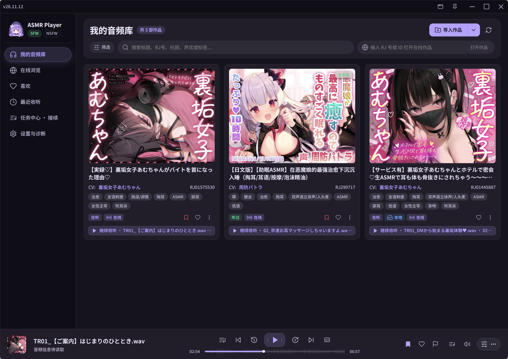
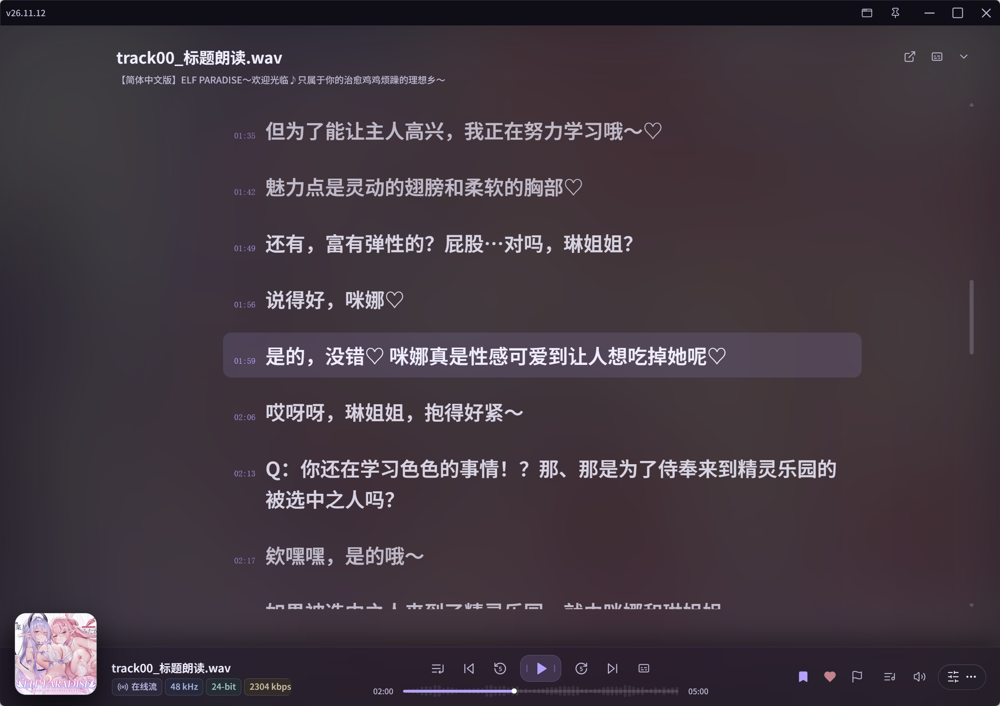
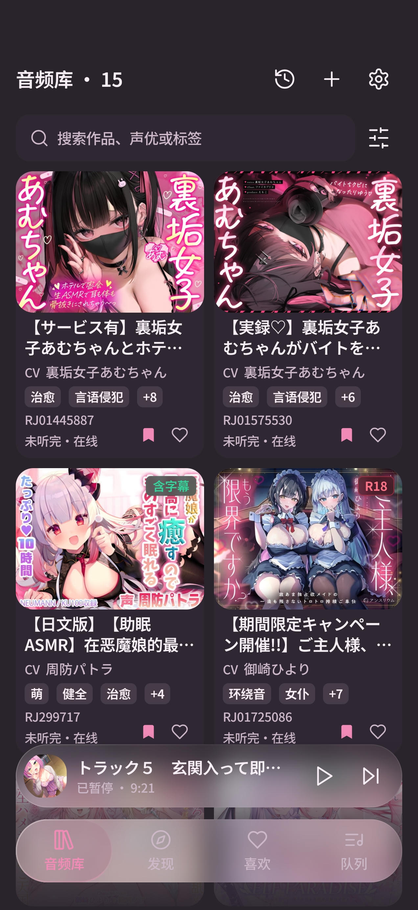
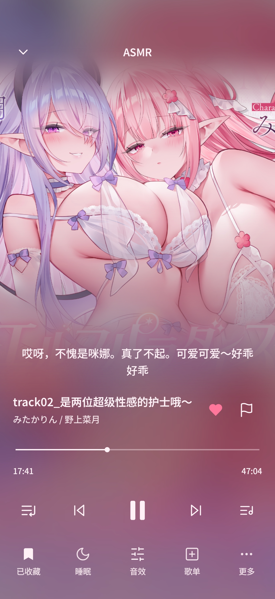
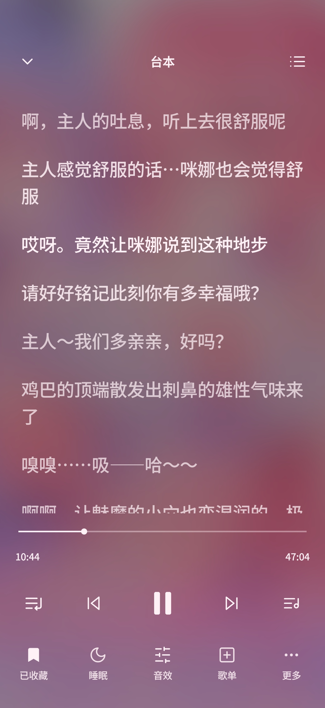
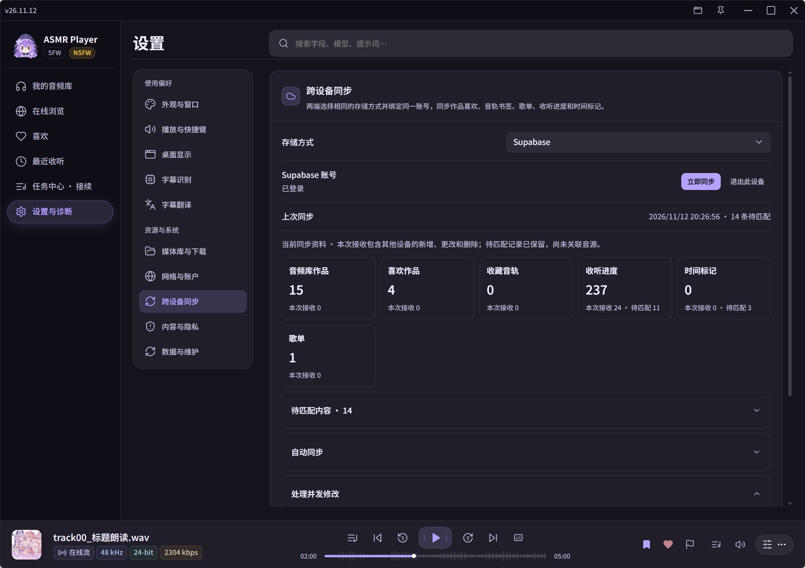
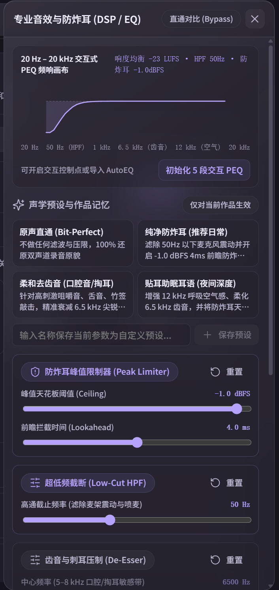
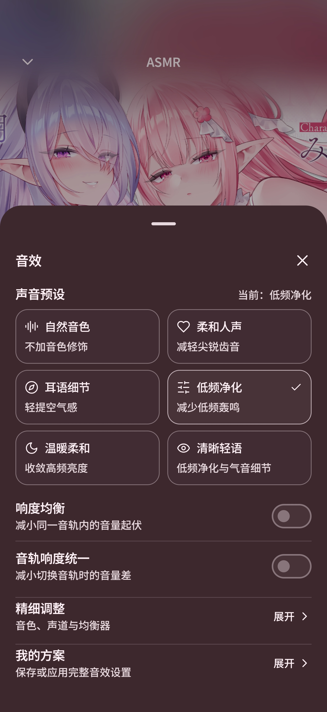

<div align="center">

  

  <h1>ASMR Player</h1>

  <p><strong>为音声收听而设计的 Windows &amp; Android 跨端播放器</strong></p>

  <p>
    在电脑上整理大容量音频库与台本，在手机上随时继续收听。<br />
    本地音频、在线作品、双语台本、专业音效与收听记录，都有自己的位置。
  </p>

  <p>
    <a href="https://github.com/Mikuku-Kawaii/ASMRplayer/releases/latest">
      
    </a>
    <a href="#下载与安装">
      
    </a>
    <a href="#下载与安装">
      
    </a>
    
    
    <a href="https://github.com/Mikuku-Kawaii/ASMRplayer/stargazers">
      
    </a>
  </p>

  <p>
    <a href="https://github.com/Mikuku-Kawaii/ASMRplayer/releases/latest"><strong>下载最新版本</strong></a>
    &nbsp;·&nbsp;
    <a href="#界面预览">界面预览</a>
    &nbsp;·&nbsp;
    <a href="#核心特性">核心特性</a>
    &nbsp;·&nbsp;
    <a href="#跨设备同步">跨设备同步</a>
    &nbsp;·&nbsp;
    <a href="docs/releases/v26.11.21.md">更新说明</a>
    &nbsp;·&nbsp;
    <a href="https://github.com/Mikuku-Kawaii/ASMRplayer/issues">问题反馈</a>
  </p>

</div>

---

## 界面预览

**Windows** 适合整理大容量音频库、离线语音识别与沉浸听读；**Android** 将完整音频库、后台播放、小组件与双语台本带到随身设备。两端绑定同一存储服务后，即可自动同步作品资料、歌单与收听进度。

### Windows 桌面端

<table>
  <tr>
    <td align="center" width="50%">
      
      <br />
      <sub><strong>音频库</strong> · 整理本地与在线作品</sub>
    </td>
    <td align="center" width="50%">
      
      <br />
      <sub><strong>沉浸台本</strong> · 跟随声音逐句阅读</sub>
    </td>
  </tr>
</table>

### Android 移动端

<table>
  <tr>
    <td align="center" width="33%">
      
      <br />
      <sub><strong>音频库</strong> · 随时浏览与检索</sub>
    </td>
    <td align="center" width="33%">
      
      <br />
      <sub><strong>播放页</strong> · 简洁控制与睡眠定时</sub>
    </td>
    <td align="center" width="33%">
      
      <br />
      <sub><strong>双语台本</strong> · 点击封面展开与跳转</sub>
    </td>
  </tr>
</table>

---

## 核心特性

<table>
  <tr>
    <td width="33%" valign="top">
      <strong>音频库与在线聚合</strong><br /><br />
      支持本地目录导入与 <code>asmr.one</code> 在线浏览、账号登录、断点续传下载；通过喜欢、音轨收藏、歌单与时间笔记构建个人音频库。
    </td>
    <td width="33%" valign="top">
      <strong>双语台本与 AI 字幕</strong><br /><br />
      同步显示原文与译文台本，支持时间轴偏移与点击跳转；Windows 端内置多引擎本地语音识别与 Ollama / DeepSeek 字幕翻译。
    </td>
    <td width="33%" valign="top">
      <strong>专业音效与睡前体验</strong><br /><br />
      内置参数均衡器、AutoEQ 耳机校准、峰值防炸耳限制器、A–B 区间循环、睡眠渐弱定时，以及 Windows 桌面灵动岛与 WASAPI 独占。
    </td>
  </tr>
</table>

### 双端能力一览

| 功能模块 | Windows 桌面端 | Android 移动端 |
| :--- | :---: | :---: |
| 本地目录导入、文件偏好自动匹配（效果音 / 格式） | ✅ | ✅ |
| `asmr.one` 在线浏览、个人推荐登录、断点续传下载 | ✅（支持批量任务） | ✅（按作品管理） |
| 双语台本显示、时间与译文偏移、点击跳转 | ✅（含独立桌面歌词） | ✅（封面展开台本） |
| 本地语音识别（SenseVoice / Whisper / Kotoba）与翻译 | ✅ | — |
| 歌单、A–B 区间循环、睡眠定时 | ✅（含渐弱淡出、保存区间） | ✅ |
| 专业音效、AutoEQ 均衡器与耳机方案 | ✅（含峰值限制器、WASAPI 独占） | ✅（含实时 / 整轨响度均衡） |
| 系统集成体验 | 桌面灵动岛、全局快捷键、SMTC | 后台播放、锁屏通知、桌面小组件 |
| 跨设备云同步（Gist / OneDrive / WebDAV / Supabase） | ✅ | ✅ |

---

## 功能详解

### 台本阅读、语音识别与翻译

- **双语台本跟随**：为音轨绑定原文与译文字幕后，播放页随进度高亮当前句子；支持独立调节整体时间与译文偏移，在完整台本或时间轴中点击任意句子即可跳转。
- **多形态展示**：Android 支持附件绑定、外部导入与封面展开台本；Windows 额外提供独立桌面歌词窗口，并可在桌面灵动岛中实时显示字幕。
- **Windows 按需识别与翻译**：
  - **本地语音识别**：可选 `SenseVoice`、`Whisper`、`Faster-Whisper` 或面向日语优化的 `Kotoba-Whisper`，模型与运行库按需下载，进度统一在任务中心管理。
  - **字幕翻译与校对**：支持本地 `Ollama` 模型或 `DeepSeek API`，可自定义翻译参数、术语词库与提示词；完成后可直接在字幕文档中编辑文本、执行时间同步与台本对齐。

> [!NOTE]
> 语音识别的速度与准确率取决于音源质量、所选模型与本机硬件；使用 DeepSeek API 翻译会将字幕文本发送至对应服务并按量计费。Android 端目前聚焦已有字幕的导入、绑定与双语阅读。

### 桌面灵动岛与日常播放

- **Windows 桌面灵动岛**：收起主窗口后仍可在桌面顶部查看当前曲目与实时字幕。展开后支持播放控制、切轨、进度拖拽、音量调节、作品操作与脱敏模式，与主窗口共享播放状态。
- **歌单与播放队列**：可将作品优先音轨或单首音轨加入歌单并跨端同步；移除队列或删除歌单不会影响本地原始音频文件。
- **A–B 区间循环**：自由设定 A/B 节点反复收听精选片段，Windows 支持保存循环区间以便下次快速启用。
- **睡眠定时**：支持指定分钟后暂停或当前音轨播完后暂停，Windows 额外提供渐弱淡出时长，随时可取消。
- **WASAPI 独占输出（Windows）**：支持独占所选耳机或音频输出设备，减少系统混音干扰，随时切回共享模式。

### 在线浏览、下载管理与文件偏好

- **在线发现与个人推荐**：在 Windows「在线浏览」或 Android「发现」中切换「推荐作品」即可浏览 `asmr.one` 推荐；支持在推荐页或设置中登录官网账号查看个人推荐。
- **按需下载与断点续传**：按目录或单文件选择下载音频、字幕与图片，支持暂停、继续与重试。未完成下载使用临时文件隔离，不会误入可播放列表；本地作品、在线来源与已下载文件围绕同一音轨统一管理，不割裂收听记录。

<details>
<summary><strong>展开查看：智能文件偏好匹配规则</strong></summary>

在 Windows「设置 → 通用 → 文件偏好」或 Android「设置 → 播放与字幕 → 文件偏好」中，可分别设定 **有 / 无效果音** 与 **MP3 / WAV** 偏好（或留空不指定），配置于各端本机自动保存：

- 双端优先展示正片目录，再依偏好匹配效果音与音频格式；
- 同等匹配条件下，优先选择上次未听完的目录，其余目录仍可随时手动切换；
- 兼容简体中文、繁体中文及 `SEあり` / `SEなし` 等常见目录命名，且不会将「无背景音乐」误判为「无效果音」。

</details>

---

## 跨设备同步

在电脑上整理音频库、维护歌单，出门后打开手机即可无缝接续同一部作品与上次的收听进度。

<p align="center">
  <br />
  <sub><strong>跨设备同步</strong> · 存储服务选择、资料统计与待匹配项管理</sub>
</p>

| 同步类别 | 同步内容说明 |
| :--- | :--- |
| **作品与收藏** | 音频库作品目录、喜欢的作品、收藏音轨及对应作品元数据 |
| **歌单** | 歌单名称、音轨列表、排序以及新增、编辑与删除记录 |
| **收听记录** | 音轨播放进度、完播状态，以及带时间戳与笔记的标记 |
| **继续收听** | 检测到其他设备有较新进度且本机音源可用时提供接续入口，不打断当前播放 |

<details>
<summary><strong>展开查看：双端绑定步骤与匹配说明</strong></summary>

1. 在 Windows 与 Android 的「设置 → 跨设备同步」中选择**同一种**存储方式：**GitHub Gist**、**OneDrive**、**WebDAV** 或 **Supabase**。
2. 两端绑定同一账号或同一 WebDAV 路径，首次绑定会自动拉取并上传资料。
3. 后续可随时点击「立即同步」或启用后台自动同步；若出现并发冲突，可在同步页选择保留版本。

> [!IMPORTANT]
> 同步仅交换元数据与收听记录，**不会上传或传输本地音频文件**。在线音轨通过稳定来源信息自动匹配，本地音频通过文件指纹匹配；尚未匹配的记录会被保留，待目标设备导入对应音频后自动衔接。
>
> 更多细节请参阅 [跨设备同步说明](docs/releases/DEVICE_SYNC.md)。注：Supabase 新用户的注册确认邮件可能受当前邮件服务投递限制。

</details>

---

## 专业音效与耳机调音

从原声直通起步，也可针对不同作品、耳机与收听习惯精细打磨音色。Windows 提供专业音效抽屉，Android 在播放页内置常用预设与精细调音入口，双端均可保存自定义方案。

<table>
  <tr>
    <td align="center" width="50%">
      
      <br />
      <sub><strong>Windows</strong> · 参数均衡器、音色预设与峰值限制器</sub>
    </td>
    <td align="center" width="50%">
      
      <br />
      <sub><strong>Android</strong> · 快捷音色预设、响度均衡与精细调音</sub>
    </td>
  </tr>
</table>

| 平台 | 音效与调音亮点 |
| :--- | :--- |
| **Windows** | **预设与旁路对比**（原声直通、低频净化、柔和齿音等，支持按作品记忆）；**交互式参数均衡器**（支持导入 AutoEQ / Equalizer APO 配置）；**低频高通、齿音与空气感调节**；**峰值限制器**（可调阈值与前瞻时间，有效防炸耳）。 |
| **Android** | **6 种快捷音色**（自然音色、柔和人声、耳语细节、低频净化、温暖柔和、清晰轻语）+ 均衡器 / 声道 / AutoEQ 细调；**实时响度均衡与整轨响度统一**（支持本地与已下载音轨，详见 [Android 响度均衡说明](docs/releases/ANDROID_LOUDNESS.md)）；**输出设备方案关联**。 |

> [!TIP]
> 所有音效均支持一键开启或旁路对比；最终听感仍受系统音频链路、蓝牙编解码与耳机硬件特性影响。

---

## 下载与安装

前往 [GitHub Releases](https://github.com/Mikuku-Kawaii/ASMRplayer/releases/latest) 获取对应平台的最新安装包：

| 平台 | 推荐安装包 | 系统要求 | 安装方式 |
| :--- | :--- | :--- | :--- |
| **Windows** | `x64-setup.exe` / `.msi` | Windows x64 | 双击安装包，按向导完成安装 |
| **Android** | `universal.apk` | Android 6.0 及以上 | 在手机上打开 APK，按系统提示允许安装 |

安装完成后，在音频库添加本地目录或从「在线浏览 / 发现」选择作品即可开始收听。Android 首次导入本地目录时，需通过系统文件选择器授予目录访问权限。

---

## 从源码构建

<details>
<summary><strong>Windows 桌面端 · Tauri 2 / React / Rust / SQLite / libmpv</strong></summary>

准备 **Node.js**、**pnpm**、**Rust** 与 **Visual Studio C++ 构建工具**，在仓库根目录执行：

```powershell
pnpm install --frozen-lockfile
./scripts/fetch-runtime.ps1
pnpm tauri dev
```

</details>

<details>
<summary><strong>Android 移动端 · Kotlin / Jetpack Compose / Media3 / Room</strong></summary>

准备 **JDK 17** 与 **Android SDK 36**，在仓库根目录执行：

```powershell
pnpm install --frozen-lockfile
.\android\gradlew.bat -p android :app:assembleDebug
```

也可使用 Android Studio 直接打开 `android/` 目录，详见 [Android 开发说明](android/README.md)。

</details>

---

<div align="center">
  <a href="docs/releases/UPDATING.md">签名与更新机制</a>
  &nbsp;·&nbsp;
  <a href="docs/releases/TODO.md">开发计划</a>
  &nbsp;·&nbsp;
  <a href="docs/releases/DEVICE_SYNC.md">同步说明</a>
  &nbsp;·&nbsp;
  <a href="https://github.com/Mikuku-Kawaii/ASMRplayer/issues">问题反馈</a>
</div>
