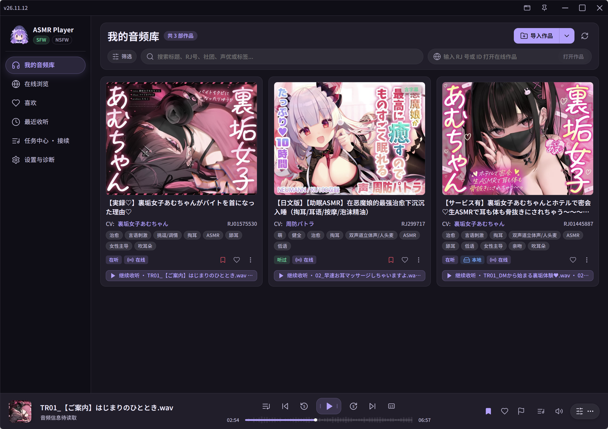
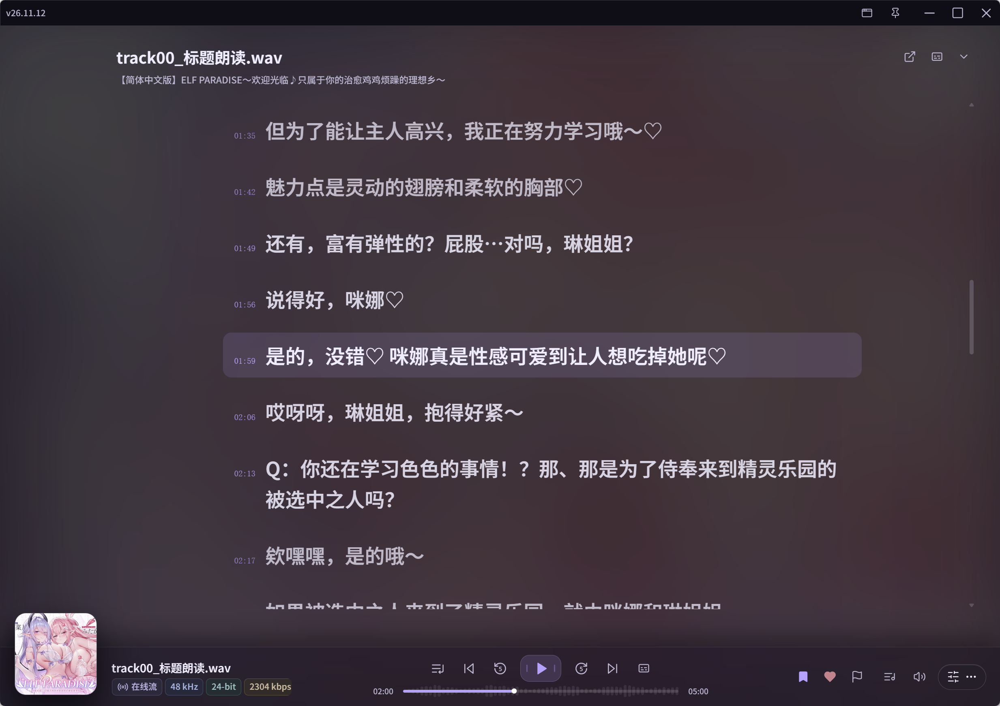
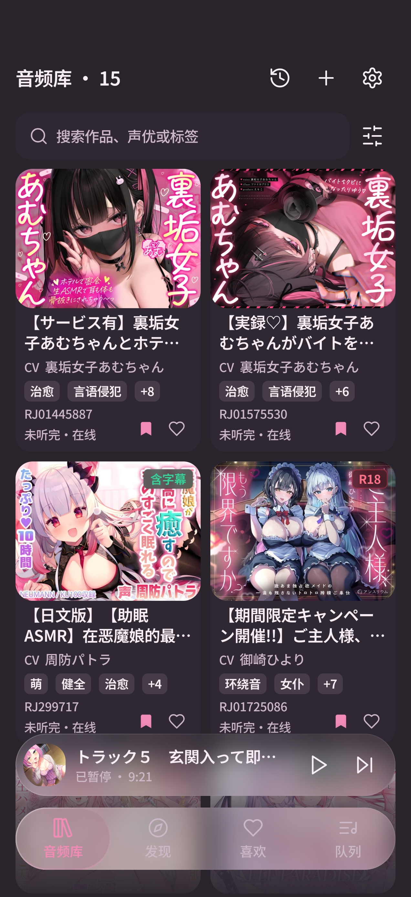
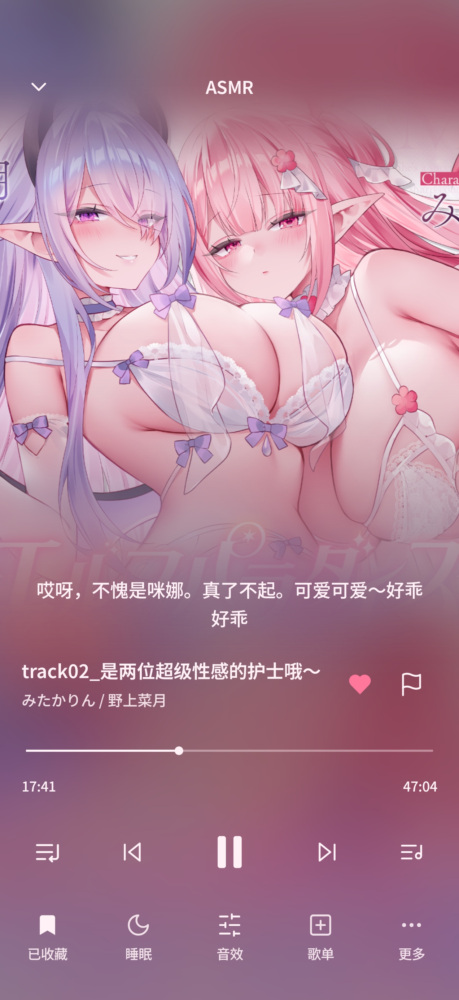
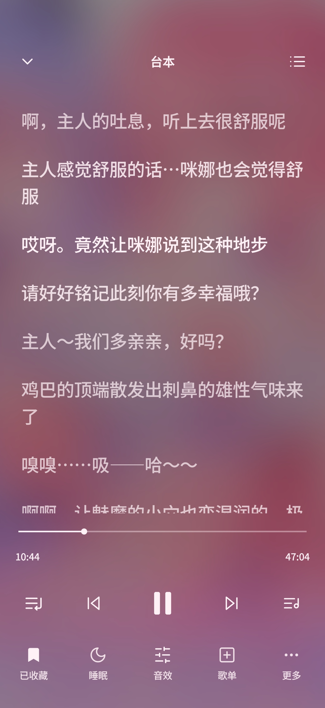

<div align="center">
  

  <h1>ASMR Player</h1>
  <p><strong>为音声收听而设计的 Windows &amp; Android 播放器</strong></p>
  <p>在电脑上整理作品，在手机上继续收听。<br />
  本地音频、在线作品、双语台本与收听记录，都有自己的位置。</p>
  <p><a href="https://github.com/Mikuku-Kawaii/ASMRplayer/releases/latest">下载最新版本</a> · <a href="docs/releases/v26.11.12.md">更新说明</a> · <a href="https://github.com/Mikuku-Kawaii/ASMRplayer/issues">反馈问题</a></p>
</div>

---

## 在喜欢的设备上收听

**Windows** 适合整理大容量音频库、管理字幕与沉浸收听；**Android** 把音频库、后台播放和双语台本带到手机。两端可以绑定同一种存储服务，同步作品资料与收听记录。

### Windows

<table>
  <tr>
    <td align="center"><br /><sub>音频库 · 整理你的作品</sub></td>
    <td align="center"><br /><sub>沉浸台本 · 跟随声音阅读</sub></td>
  </tr>
</table>

### Android

<table>
  <tr>
    <td align="center" width="33%"><br /><sub>音频库</sub></td>
    <td align="center" width="33%"><br /><sub>播放页</sub></td>
    <td align="center" width="33%"><br /><sub>双语台本</sub></td>
  </tr>
</table>

## 为每次收听准备好

- **建立自己的音频库**：导入本地文件夹，也可以在线浏览作品并下载。用作品喜欢、音轨收藏、歌单和时间标记整理想听的内容。
- **跟着台本一起听**：关联原文与译文，调整时间偏移。手机上点封面展开台本、点句子跳转；Windows 还提供独立桌面歌词，并支持配置语音识别与翻译。
- **从上次的位置继续**：通过 GitHub Gist、OneDrive、WebDAV 或 Supabase 同步作品资料、喜欢、歌单、进度和时间标记。[查看同步范围与绑定说明](docs/releases/DEVICE_SYNC.md)
- **让播放融入日常**：Windows 提供桌面灵动岛、快捷键和系统媒体控制；Android 支持后台播放、锁屏与通知控制、桌面小组件。两端均有均衡器和睡眠定时。

> 同步不传输本地音频文件。本地作品需要在目标设备另行导入或授权；在线音轨可根据同步的来源信息匹配。Supabase 注册确认邮件受当前邮件服务的投递限制。

## 下载与安装

前往 [GitHub Releases](https://github.com/Mikuku-Kawaii/ASMRplayer/releases/latest)，选择适合设备的安装包：

| 平台 | 安装包 | 安装方式 |
| --- | --- | --- |
| Windows x64 | `x64-setup.exe` 或 `.msi` | 打开安装包，按照向导完成安装。 |
| Android 6.0 及以上 | `universal.apk` | 在手机上打开 APK，按系统提示允许安装。 |

安装后，在音频库添加本地目录，或从在线浏览选择一部作品。Android 首次导入时，需要通过系统文件选择器授予目录访问权限。

## 从源码运行

<details>
<summary><strong>Windows · Tauri 2 / React / Rust / SQLite / libmpv</strong></summary>

准备 Node.js、pnpm、Rust 和 Visual Studio C++ 构建工具，然后在仓库根目录运行：

```powershell
pnpm install --frozen-lockfile
./scripts/fetch-runtime.ps1
pnpm tauri dev
```

</details>

<details>
<summary><strong>Android · Kotlin / Jetpack Compose / Media3 / Room</strong></summary>

准备 JDK 17 和 Android SDK 36，然后在仓库根目录运行：

```powershell
pnpm install --frozen-lockfile
.\android\gradlew.bat -p android :app:assembleDebug
```

也可以用 Android Studio 打开 `android/`。[Android 开发说明](android/README.md)

</details>

---

<div align="center">
  <a href="docs/releases/UPDATING.md">签名与更新机制</a> ·
  <a href="docs/releases/TODO.md">开发计划</a> ·
  <a href="https://github.com/Mikuku-Kawaii/ASMRplayer/issues">问题反馈</a>
</div>
