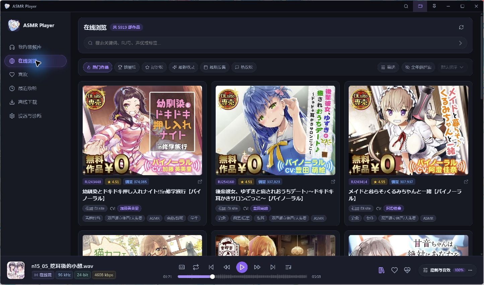
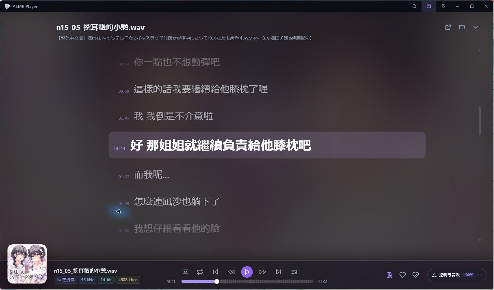
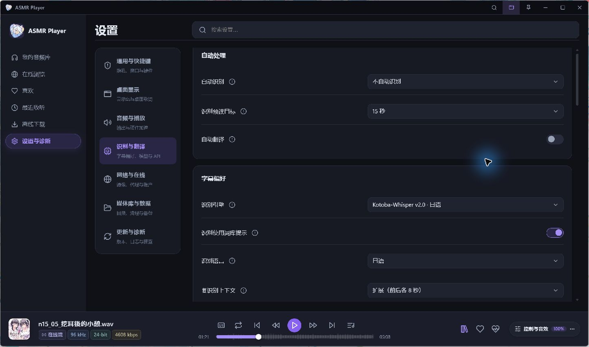
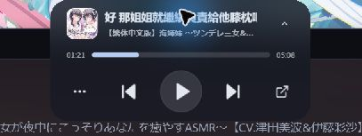

<div align="center">


# ASMR Player

**把作品、声音和字幕，放进同一段收听时光。**

面向 Windows 的 ASMR 桌面播放器 · 本地音频库 · 在线作品 · 识别与翻译

[**下载最新版**](https://github.com/Mikuku-Kawaii/ASMRplayer/releases/latest)　/　[更新记录](docs/releases/v1.3.0.md)　/　[开发计划](docs/releases/TODO.md)　/　[反馈问题](https://github.com/Mikuku-Kawaii/ASMRplayer/issues)

`Windows x64`　`Tauri 2 + React`　`Rust + libmpv`　`当前发布 1.3.0`



<sub>实际应用截图 · SFW / 全年龄模式 · 作品封面与字幕归各自权利人所有</sub>

</div>

---

## 从发现作品，到安心入睡

| 收藏与续播 | 听见，也看懂 | 留在桌面的一角 |
| :--- | :--- | :--- |
| 本地与在线作品统一管理，记住每部作品听到了哪一轨、哪一秒。 | 同步字幕、本地语音识别与字幕翻译，让长音轨更容易跟上。 | 灵动岛、桌面歌词、系统媒体键与睡眠定时，减少来回切换。 |

**1.3.0 的重点**：本地识别、多模型选择、Ollama / DeepSeek 翻译，以及字幕任务、编辑与台本对齐。[查看完整更新说明 →](docs/releases/v1.3.0.md)

## 界面一览

### 01 · 浏览作品，随时接着听

关键词、RJ 号、声优与标签检索，配合榜单、排序和全年龄筛选，快速找到想听的内容。底部播放栏始终保留进度、音频信息与常用控制。

本地音频库支持作品文件夹导入、自然顺序音轨、收藏、最近收听与增量扫描；离线下载完成后，同一音轨可沿用已有进度和书签。

### 02 · 让字幕成为播放画面



大字台词随音轨进度显示，当前句清晰高亮。支持 **SRT / VTT / LRC** 字幕匹配、手动绑定、时间偏移、搜索和点击台词跳转，也可在桌面歌词与灵动岛中查看字幕。

### 03 · 识别与翻译，按自己的习惯配置



| 能力 | 可用方式 |
| :--- | :--- |
| 本地识别 | SenseVoice、Whisper、Faster-Whisper、日语专用 Kotoba-Whisper；按需安装模型和运行库。 |
| 字幕翻译 | 本机 Ollama 或 DeepSeek API；支持全文翻译、词库、上下文提示与 Prompt 设置。 |
| 任务管理 | 手动、目录批量或播放时自动处理，查看进度、取消、重试。 |
| 字幕整理 | 编辑台词与译文、同步时间轴、对齐台本，删除生成结果时保留原始字幕文件。 |

模型默认不下载。识别效果与速度取决于音源、模型和硬件；耳语与非台词声音仍在持续优化。Ollama 在本机处理；DeepSeek 会接收待翻译文本，并按其 API 使用量计费。

### 04 · 灵动岛，让控制留在手边

<p align="center">
  
</p>

紧凑胶囊与展开控制舱之间切换，查看字幕、播放进度并控制切歌。支持置顶、屏幕选择、大小调节、磁吸与滚轮调音，也可配合独立桌面歌词使用。

## 收听工具箱

| 场景 | 功能 |
| :--- | :--- |
| **睡前收听** | 睡眠定时、当前音轨结束后停止、结束前音量淡出。 |
| **反复听喜欢的片段** | 备注书签、A–B 区间循环、目录队列与循环模式。 |
| **整理作品库** | MP3、FLAC、WAV、M4A、OGG、OPUS；引用本地原文件，保留原有目录结构。 |
| **保存离线内容** | 选择下载内容与目录，暂停、继续、重试；服务器支持时断点续传。 |
| **调整声音** | 参数 EQ、AutoEQ / EqualizerAPO 参数导入、ASMR 音效预设与按作品保存配置。 |
| **桌面控制** | Windows 系统媒体控制、托盘、快捷键、灵动岛与桌面歌词。 |
| **保留收听记录** | 收藏、进度、书签、循环与配置的备份和恢复。 |

<details>
<summary><strong>展开：音频输出与音效</strong></summary>

- 低频截断、齿音频段衰减、空气感高频调节与峰值限制器，可分别开启和调整。
- 交互式参数 EQ 支持频率、增益和 Q 值；可导入耳机校准参数。
- 内置原声直通、纯净防炸耳、柔和去齿音、贴耳助眠耳语预设，并支持自定义预设。
- 左右声道互换、平衡调节与可选 BS2B 交叉馈送。
- WASAPI 共享 / 独占输出与音频信息显示；独占模式可用性取决于设备和驱动。

“原声直通”旁路应用 DSP；峰值限制器控制信号峰值，实际收听音量仍需自行调整。

</details>

## 下载与上手

### 安装

前往 [**GitHub Releases → 最新版**](https://github.com/Mikuku-Kawaii/ASMRplayer/releases/latest)，选择一种 Windows x64 安装包：

| 安装包 | 适合用途 |
| :--- | :--- |
| **EXE** · `ASMR.Player_1.3.0_x64-setup.exe` | 常规安装，推荐使用。 |
| **MSI** · `ASMR.Player_1.3.0_x64_en-US.msi` | 需要 MSI 格式时使用。 |

安装包包含 libmpv，无需另装 mpv。界面依赖 Microsoft Edge WebView2；缺少运行时时，安装程序会尝试联网下载。Release 中的 `latest.json` 用于软件更新，无需手动下载。

### 开始第一段收听

1. **找作品**：导入本地作品文件夹或作品库，也可在在线浏览页搜索。
2. **开始听**：打开作品，选择目录或音轨；下次可从保存的位置继续。
3. **配字幕**：使用已有字幕，或在设置中按需安装识别模型、配置翻译服务。
4. **按习惯调整**：打开字幕、队列或音效面板，睡前设置定时，工作时使用灵动岛。

<details>
<summary><strong>使用前了解这些</strong></summary>

- 在线浏览、字幕与下载依赖第三方服务和网络；本地音频播放可独立使用。
- 模型与运行库按需下载，不随安装包捆绑；GPU 运行方式取决于所选模型、显卡和驱动。
- 升级安装保留已有用户数据库与媒体文件；备份文件不包含音频、封面或字幕原文件。
- 可在设置中检查更新。安装由用户明确触发，更新包需通过签名验证。
- 截图为 SFW 模式下的实际界面，展示内容与第三方服务的实时结果可能不同。

</details>

## 开发与构建

**Tauri 2 · React 18 · TypeScript · Rust · SQLite · libmpv**

Windows 开发环境需要 Node.js 22、pnpm、Rust stable、MSVC C++ Build Tools 与 WebView2。

```powershell
git clone https://github.com/Mikuku-Kawaii/ASMRplayer.git
cd ASMRplayer
pnpm install --frozen-lockfile
powershell -ExecutionPolicy Bypass -File scripts/fetch-runtime.ps1
pnpm tauri dev
```

<details>
<summary><strong>运行库、签名发布与维护说明</strong></summary>

播放运行库不提交到 Git。`fetch-runtime.ps1` 从已发布安装包提取 DLL 并校验固定 SHA-256，详见 [运行库说明](src-tauri/binaries/README.md)。

发布者通过 `scripts/prepare-release.ps1` 检查、打包和签名，流程见 [UPDATING.md](docs/releases/UPDATING.md)。自行构建需使用自己的签名密钥和对应公钥，不能签发本项目官方客户端信任的更新。

项目维护技能位于 [`.agents/skills/`](.agents/skills/)，包含架构、M3 界面和专业音频 DSP 规范。仓库不包含用户媒体、数据库、日志、模型或签名私钥。

</details>

## 计划与反馈

- 继续优化识别和翻译。
- 计划重构 UI。

[开发计划](docs/releases/TODO.md) · [提交问题](https://github.com/Mikuku-Kawaii/ASMRplayer/issues) · [历史版本](https://github.com/Mikuku-Kawaii/ASMRplayer/releases)

反馈时请附上应用版本、Windows 版本与复现步骤，并移除日志中的私人路径、凭据及私人作品信息。

---

<p align="center">
  <sub>第三方组件许可见 <a href="licenses/">licenses</a>。在线作品、封面和字幕归各自权利人所有，本项目不附带作品音频。</sub>
</p>
