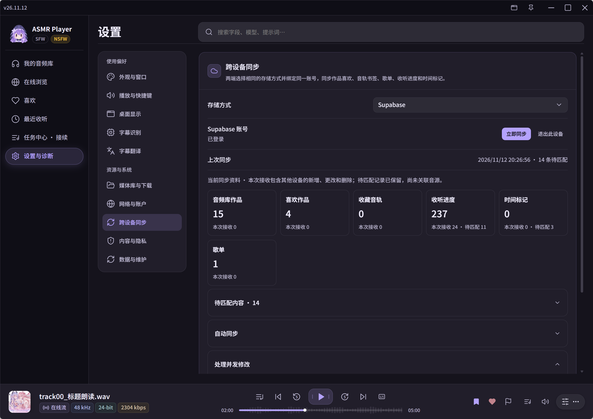
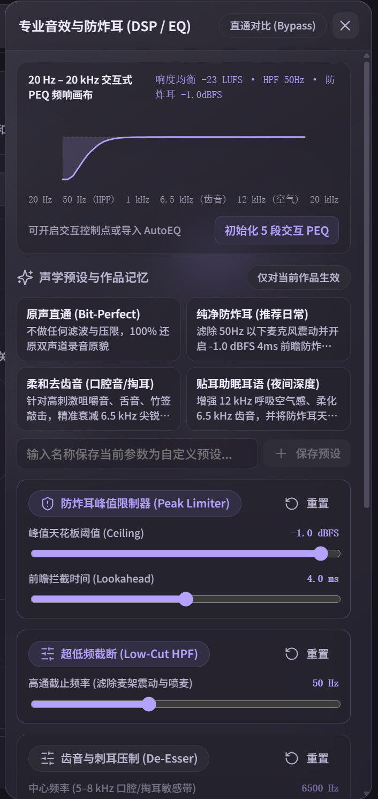
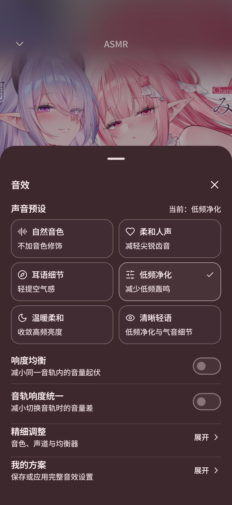

<div align="center">
  

  <h1>ASMR Player</h1>
  <p><strong>为音声收听而设计的 Windows &amp; Android 播放器</strong></p>
  <p>在电脑上整理作品，在手机上继续收听。<br />
  本地音频、在线作品、双语台本与收听记录，都有自己的位置。</p>
  <p><a href="https://github.com/Mikuku-Kawaii/ASMRplayer/releases/latest">下载最新版本</a> · <a href="docs/releases/v26.11.12.md">更新说明</a> · <a href="https://github.com/Mikuku-Kawaii/ASMRplayer/issues">反馈问题</a></p>
</div>

---

## 在喜欢的设备上收听

**Windows** 适合整理大容量音频库、管理字幕与沉浸收听；**Android** 把音频库、后台播放和双语台本带到手机。两端可以绑定同一种存储服务，同步作品资料与收听记录。

### Windows

<table>
  <tr>
    <td align="center"><br /><sub>音频库 · 整理你的作品</sub></td>
    <td align="center"><br /><sub>沉浸台本 · 跟随声音阅读</sub></td>
  </tr>
</table>

### Android

<table>
  <tr>
    <td align="center" width="33%"><br /><sub>音频库</sub></td>
    <td align="center" width="33%"><br /><sub>播放页</sub></td>
    <td align="center" width="33%"><br /><sub>双语台本</sub></td>
  </tr>
</table>

## 为每次收听准备好

- **建立自己的音频库**：导入本地文件夹，也可以在线浏览作品并下载。用作品喜欢、音轨收藏、歌单和时间标记整理想听的内容。
- **跟着台本一起听**：关联原文与译文，调整时间偏移。手机上点封面展开台本、点句子跳转；Windows 还提供独立桌面歌词，并支持配置语音识别与翻译。
- **让播放融入日常**：Windows 提供桌面灵动岛、快捷键和系统媒体控制；Android 支持后台播放、锁屏与通知控制、桌面小组件。两端均支持睡眠定时。

## 台本、字幕识别与翻译

### 双语台本，跟着播放阅读

为音轨选择原文和译文字幕后，播放页会随时间显示当前句子。可以分别调整整体时间和译文偏移，打开完整台本或字幕时间轴查看上下文，再点击句子跳转到对应位置。Android 支持从作品附件绑定或导入已有字幕；Windows 还可以使用独立的桌面歌词窗口与灵动岛显示字幕。

### Windows · 按需识别与翻译

没有合适字幕时，可以在 Windows 端为音轨启动识别，再生成或整理译文：

- **本地语音识别**：可选择 SenseVoice、Whisper、Faster-Whisper 或面向日语的 Kotoba-Whisper。模型和运行库按需下载，识别进度可在任务中心查看。
- **字幕翻译**：可使用本机 Ollama 模型，或配置 DeepSeek API；支持翻译参数、词库和提示词设置，也可以按需开启自动处理。
- **阅读与修正**：识别或翻译后，可在字幕文档中检查、编辑文本，并使用时间同步和台本对齐工具调整结果。

识别效果与速度取决于音源、模型和硬件；DeepSeek 翻译会发送字幕文本并按服务使用量计费。Android 当前提供已有字幕的导入、绑定、双语显示和偏移调整，不包含自动识别与翻译。

## Windows 桌面灵动岛

收起主窗口后，也可以通过桌面灵动岛查看当前曲目或字幕。展开后可直接播放、暂停、切换音轨，拖动进度条跳转，或打开主窗口；菜单里还提供音量调整、作品操作和脱敏模式。

灵动岛与主窗口使用同一个播放状态。可在设置中调整显示、位置和字幕相关选项，也可以配合独立桌面歌词窗口使用。

## 在线浏览与下载管理

从在线作品中选择需要的目录或文件，下载音频、字幕、图片等内容，在离线时继续收听或阅读。下载管理显示任务状态与进度，提供暂停、继续、重试等操作；Windows 还支持批量处理任务，Android 可按作品查看下载文件。

下载使用临时文件并支持断点续传；尚未完成的文件不会当作可播放音源。音频库中的本地作品、在线来源和已完成下载可围绕对应音轨管理，不必把每种来源当成一份全新的收听记录。

## 歌单、循环与睡前收听

- **歌单与队列**：把作品中的优先音轨或单首音轨加入歌单，调整顺序并跨设备同步。当前播放队列可单独调整；移出队列或删除歌单不会删除原始音频文件。
- **A–B 区间循环**：在音轨中设置 A 点和 B 点，反复收听选定片段。Windows 可保存循环区间，方便之后重新启用；Android 可在播放器的播放工具中设置和关闭。
- **睡眠定时**：选择若干分钟后暂停，或让当前音轨播完后暂停。Windows 还可以选择渐弱淡出时长；定时也可以随时取消。
- **Windows WASAPI 独占输出**：选择让播放器独占所选耳机或音箱，也可以切回共享模式。独占时其他应用可能暂时无法通过该设备发声，适合希望单独使用输出设备的场景。

## 电脑与手机，接着同一段声音

在电脑上整理音频库、创建歌单，出门后打开手机，也可以找到同一部作品和上次的收听位置。两端通过你选择的存储服务交换资料，并各自管理本机的音源与播放。

<p align="center">
  <br />
  <sub>跨设备同步 · 查看资料、进度与待匹配内容</sub>
</p>

| 可以同步 | 包含的内容 |
| --- | --- |
| **作品与收藏** | 音频库作品、喜欢的作品、收藏音轨与对应的作品资料。 |
| **歌单** | 歌单名称、音轨和顺序，以及歌单的新增、修改和删除。 |
| **收听记录** | 音轨进度、完成状态，以及带时间和笔记的标记。 |
| **继续收听** | 收到其他设备的较新进度且音源可用时，提供继续收听入口；同步本身不会打断当前播放。 |

### 连接两端

1. 在 Windows 和 Android 的「设置 → 跨设备同步」中，选择**同一种**存储方式：GitHub Gist、OneDrive、WebDAV 或 Supabase。
2. 两端绑定同一账号或同一个 WebDAV 位置；首次绑定会拉取并上传资料。
3. 之后可以手动点击「立即同步」，也可以按各端设置使用后台自动同步。遇到并发修改时，可在同步页选择保留的版本。

在线音轨可通过同步的稳定来源信息匹配。本地音频按文件指纹匹配；尚未匹配的记录会保留，待另一端具备相应音源后再继续匹配。**同步不传输本地音频文件**，请在目标设备另行导入或授权。

[了解同步范围、绑定方法与存储位置](docs/releases/DEVICE_SYNC.md) · Supabase 新用户的注册确认邮件受当前邮件服务投递限制。

## 为耳语、声音细节与耳机调音

从原声开始，也可以按作品、耳机和收听习惯调整音色。Windows 提供专业音效抽屉；Android 将常用预设和细调入口放在播放页，两端都可以保存自己的音效方案。

<table>
  <tr>
    <td align="center" width="50%"><br /><sub>Windows · 专业音效与防炸耳</sub></td>
    <td align="center" width="50%"><br /><sub>Android · 音效预设与细调</sub></td>
  </tr>
</table>

### Windows · 按作品细调

- **预设与旁路对比**：切换原声直通、低频净化、柔和齿音等方案，也可保存自定义预设或为当前作品记住设置。
- **均衡器与耳机校准**：使用交互式参数均衡器调整频响，或导入 AutoEQ / Equalizer APO 的参数化均衡器配置。
- **声音细节与峰值控制**：按需调整低频高通、齿音和空气感；峰值限制器提供阈值与前瞻时间设置，用于降低突发峰值。

### Android · 从预设到完整方案

- **快捷音色**：在播放页选择自然音色、柔和人声、耳语细节、低频净化、温暖柔和或清晰轻语，也可以展开均衡器、声道和 AutoEQ 细调。
- **响度选项**：实时响度均衡用于减小同一音轨内的音量起伏；音轨响度统一在完整分析后应用补偿，支持本地和已下载音轨。在线流需先下载才能进行整轨分析。
- **耳机方案**：保存完整音效设置并按需应用，也可以为输出设备关联方案。[了解 Android 响度均衡](docs/releases/ANDROID_LOUDNESS.md)

音效可以按需开启或旁路；实际输出仍受系统、蓝牙设备和音频硬件影响。

## 下载与安装

前往 [GitHub Releases](https://github.com/Mikuku-Kawaii/ASMRplayer/releases/latest)，选择适合设备的安装包：

| 平台 | 安装包 | 安装方式 |
| --- | --- | --- |
| Windows x64 | `x64-setup.exe` 或 `.msi` | 打开安装包，按照向导完成安装。 |
| Android 6.0 及以上 | `universal.apk` | 在手机上打开 APK，按系统提示允许安装。 |

安装后，在音频库添加本地目录，或从在线浏览选择一部作品。Android 首次导入时，需要通过系统文件选择器授予目录访问权限。

## 从源码运行

<details>
<summary><strong>Windows · Tauri 2 / React / Rust / SQLite / libmpv</strong></summary>

准备 Node.js、pnpm、Rust 和 Visual Studio C++ 构建工具，然后在仓库根目录运行：

```powershell
pnpm install --frozen-lockfile
./scripts/fetch-runtime.ps1
pnpm tauri dev
```

</details>

<details>
<summary><strong>Android · Kotlin / Jetpack Compose / Media3 / Room</strong></summary>

准备 JDK 17 和 Android SDK 36，然后在仓库根目录运行：

```powershell
pnpm install --frozen-lockfile
.\android\gradlew.bat -p android :app:assembleDebug
```

也可以用 Android Studio 打开 `android/`。[Android 开发说明](android/README.md)

</details>

---

<div align="center">
  <a href="docs/releases/UPDATING.md">签名与更新机制</a> ·
  <a href="docs/releases/TODO.md">开发计划</a> ·
  <a href="https://github.com/Mikuku-Kawaii/ASMRplayer/issues">问题反馈</a>
</div>
