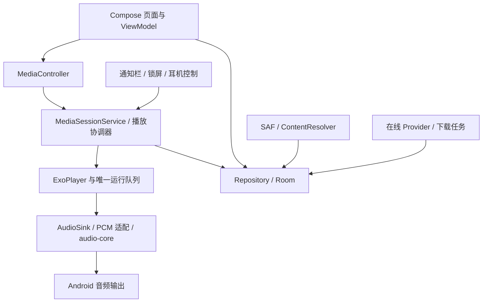

# Android 移植架构评估

评估日期：2026-11-02。任务编号与 [公开开发计划](TODO.md) 对齐。下文保留初始评估依据；同日 P0、P1 库扫描/Room/会话/字幕和 P2 在线作品/音频/字幕/图片下载与离线封面已实现，具体能力见 [接线文档](../../android/BACKEND_API.md)。Compose 已接入本地播放工具、在线发现/搜索/详情、来源设置、下载管理及附件选择/绑定；完整产品仍按公开计划分阶段推进。当前入口、构建方式和音频限制见 [Android 说明](../../android/README.md)。AN008 自动识别/翻译按用户决定取消。

## 建议与取舍

AN013 耳机音效偏好已接入实际 AudioTrack 路由和设置页；AN016.A 补齐标准媒体通知、封面隐私与系统设置入口。厂商专属胶囊准入和标准媒体兼容分开记录，详见 [耳机与系统媒体兼容说明](ANDROID_MEDIA_COMPATIBILITY.md)。

首版建议沿用已有 `android/` 方向：**Kotlin + Jetpack Compose + Media3 ExoPlayer / MediaSessionService + Room（SQLite）**。先完成本地库、后台播放、会话恢复与 DSP，再接在线作品和下载。Windows 继续使用 Tauri / React / Rust / 进程内 libmpv。

优先复用领域契约、算法规则、合成夹具与行为用例；首版按需将业务规则移植为 Kotlin，不把整份 Rust 宿主作为 Android 依赖。若后续两端规则维护出现实际成本，再提取不依赖 Tauri 的 Rust 小模块，通过 JNI / UniFFI 接入。此处选择依据是当前耦合与已有骨架，不是未经测量的语言性能判断。

| 方案 | 可复用部分 | 主要成本 | 结论 |
| --- | --- | --- | --- |
| Tauri 2 Android + React + Rust | 部分页面、DTO、纯逻辑 | 仍需原生后台服务、SAF、媒体会话；桌面多窗和插件需替换；现有播放器非 Windows 加载器直接报错 | 可行候选，但不能靠移动端打包完成移植；不作为当前首选 |
| Compose + Rust 公共核心 + 原生引擎 | 领域、数据库和部分服务在解耦后可共享 | 先拆 Tauri 事件与具体播放器、处理跨语言异步/取消/所有权、NDK/ABI，再开发移动 UI | 长期可选，不作为首版前置工程 |
| Compose + Kotlin 业务层 + Media3 | 现有 Android 骨架和 DSP 原型、桌面行为规格 | UI、存储和服务需要实现，两端规则须用共同用例约束 | **首版推荐**；先验证真实播放链路，再扩大功能 |

## 初始评估时的代码证据

| 位置 | 当前事实 | 移植含义 |
| --- | --- | --- |
| `android/app/build.gradle.kts`、根构建文件 | 已声明 Compose、Media3 1.8.0、minSdk 23、compile/targetSdk 36；AGP 8.13.0、Kotlin 2.2.20、Gradle 8.13、JDK 17 | 保留作为候选版本组合；本轮未构建，不宣称依赖兼容已验证，也不为视觉效果提高 minSdk |
| `android/app/src/main/AndroidManifest.xml` | 已声明 MainActivity、PlaybackService 和 mediaPlayback 前台服务权限；对应 Kotlin 类尚不存在 | 只是骨架，不能标记为可运行的安卓播放器 |
| `android/audio-core/` | 已有 Biquad、DspConfig、DspEngine 与 JVM 测试源码；代码使用 AN003 | 接续 AN003，不重复立项；尚无 Media3 PCM 适配和真实输出链路 |
| `src-tauri/src/player/libmpv_ffi.rs` | Windows 使用 LoadLibraryExW；非 Windows 分支返回不支持错误 | `mpv-2.dll` 及该加载器不能直接用于 Android |
| `src-tauri/src/services/playback.rs` | 直接持有 MpvController、AppHandle、NativeSmtcController | 不能原样作为共享业务核心；提取时先隔离播放器、事件和系统媒体适配 |
| `src-tauri/src/services/download.rs`、`library.rs` | 下载持有 Tauri 事件句柄，扫描使用 Path / WalkDir / fs，下载完成依赖本地更名 | 复用规则；Android 路径、URI 与后台任务实现重做 |
| `src-tauri/Cargo.toml`、`providers/mod.rs` | 托盘、更新、单实例与 windows-native keyring 配置；Provider 直接访问 keyring | Android 分别替换为系统服务/应用生命周期/Keystore 凭据存储 |
| `src-tauri/src/services/recognition.rs`、`speech_engine.rs` | 识别运行库包含 Windows DLL 和平台条件实现 | 模型、推理库、算力、温控与取消需要独立适配，不随首版打包桌面运行库 |

## 做不了、不做与可以增加

以下是 **2026-11-02 的产品范围说明**。“做不了”指现有实现不能直接搬用，或普通 Android 应用无法保证的行为；“不做”是当前方案的取舍；“可以增加”是技术上可行的候选，尚未承诺实现。首版指 P0–P1 的本地播放器，P2 补在线与下载，P3 处理签名发布和数据迁移。

### 做不了：不能原样移植或不能保证

| 项目 | 明确边界 | Android 替代方案 |
| --- | --- | --- |
| Windows 播放与识别运行库 | `mpv-2.dll`、Windows 识别 DLL、WASAPI、SMTC 和桌面安装器不能直接在 Android 运行；这不等于 Android 不能播放或识别 | 播放采用 Media3 与原生媒体会话；必要时另评估 libmpv `.so`。识别/翻译已按用户决定取消 |
| 任意磁盘扫描与原路径复用 | 不能沿用 Windows 盘符、任意绝对路径或把单文件授权当作整目录授权；SAF 在 Android 11+ 也限制部分根目录及 Android/data、Android/obb 的选择 | 用户选择可授权作品目录，保存 URI；导入后按稳定作品/版本身份关联，失效时重新授权。[SAF 限制](https://developer.android.com/training/data-storage/shared/documents-files) |
| 无条件后台常驻 | 不能保证任意时刻从后台启动、被系统终止后永不断播、用户强停后仍运行，或下载/推理无限后台执行 | 播放使用媒体前台服务；长任务保存进度并遵守调度限制，清楚显示暂停/中断。[后台服务启动限制](https://developer.android.com/develop/background-work/services/fgs/restrictions-bg-start) |
| 桌面外壳一比一还原 | Windows 托盘、多显示器独立窗口、系统级快捷键与桌面灵动岛实现不能照搬；普通应用不能直接改造所有厂商的系统锁屏/状态栏 | 通知/锁屏/耳机媒体控制、应用内迷你播放器；后续可做桌面小组件。系统媒体界面的样式由系统决定。[后台媒体会话](https://developer.android.com/media/media3/session/background-playback) |
| 所有手机具有桌面级音频输出 | 当前适配源码走 PCM16，内部浮点 DSP 不代表端到端高位深；不能由算法旁路推导出全设备 bit-perfect、固定采样率或蓝牙无损 | 记录实际支持的格式和输出路由；高位深、USB DAC 或其他引擎作为独立评估，不能提前标成支持 |
| 复制桌面数据库即可继续用 | Windows 文件路径、平台配置和凭据不能直接成为 Android 可用来源；覆盖 SQLite 文件不等于完成跨端迁移 | AN009 提供版本化导入/导出，迁移可对应的收藏/进度/书签，再匹配媒体与重新授权 |

### 不做：当前范围主动排除或暂缓

| 取舍 | 当前决定与原因 | 后续是否可重议 |
| --- | --- | --- |
| 桌面界面与宿主整套搬入 | 不把三栏 React 页面压缩到手机，也不把整个 Tauri/Rust 宿主作为首版前置依赖；接续 Compose 原生实现 | 可按实际重复维护成本提取小型公共核心 |
| 跨应用悬浮歌词/灵动岛 | 首版不申请悬浮窗权限、不覆盖其他应用；先完成应用内字幕和系统媒体控制 | 技术上可另做悬浮层，但需单独确定权限、遮挡与耗电取舍；不是“Android 做不了” |
| 字幕自动识别、翻译与模型 | 用户于 2026-11-02 明确不需要，AN008 取消；Android 仅导入/展示已有字幕 | 不开发手机推理、模型管理或远端识别/翻译代理；不影响现成双语字幕读取 |
| 跨设备账号同步 | AN018 通过 GitHub Gist、OneDrive、WebDAV 或 Supabase 同步收藏、书签与进度，AN018.A 提供前台与后台周期同步 | 存储配置和设备匹配规则见 [跨设备同步说明](DEVICE_SYNC.md) |
| 多设备生态与复杂转场 | 暂不安排 Android Auto、Wear OS、电视端、投屏或双空间转场；液态玻璃底栏已按用户最新要求纳入 AN007 设计 | 多设备能力可独立评估；投屏的远端播放不会自动经过手机本地 DSP |

### 可以增加：移动端候选能力

以下保留扩展候选与选入后的进展。优先级是建议顺序，公开清单与本地清单沿用相同 ID；只有选入阶段后才成为交付范围。AN010–AN015 均已按用户后续选择纳入并实现。既有通知/锁屏/耳机控制、字幕、A–B、普通睡眠定时与离线下载仍属于 AN002–AN007，不重复列为新增功能。

| ID / 建议顺序 | 可以增加什么 | 用户收益与实现边界 |
| --- | --- | --- |
| AN010 / 已实现 | 手机桌面播放小组件 | 桌面直接继续播放、暂停、切歌或打开最近作品；复用同一媒体会话，标题跟随隐私设置，不展示封面、不另起播放器；点击控制通过前台入口连接会话。[Android 小组件](https://developer.android.com/develop/ui/views/appwidgets/overview) |
| AN011 / 已实现 | 从其他应用“打开/分享至 ASMR Player” | 从文件管理器导入音频/字幕，或接收受支持的作品链接；临时 URI 不能当永久库来源，需要复制或补充持久授权，链接识别复用 AN006。[接收分享](https://developer.android.com/develop/ui/compose/sharing/receive) |
| AN012 / 已实现 | 睡前模式增强 | 在 AN005 普通定时之上增加逐渐淡出、播完本轨再停、快捷延长；深色夜间页与大按钮便于操作，不改变系统亮度。定时和淡出由播放服务控制，不依赖屏幕常亮 |
| AN013 / 已完成 | 按耳机/输出设备保存音效偏好 | 命名方案、手动应用、实际输出关联、自动切换和通用回退已接入；不能稳定识别的设备保留手动选择，详见 [兼容说明](ANDROID_MEDIA_COMPATIBILITY.md) |
| AN014 / 已实现 | 平板、折叠屏与横屏布局 | 大屏并列展示作品列表、详情或字幕，沿用同一播放与数据状态；按窗口大小适配，不复制 Windows 多窗口外壳 |
| AN018 / AN018.A | 多存储跨设备资料同步 | PC 与 Android 使用同一存储与账号，分别在应用文件夹或秘密 Gist 中合并元数据。见 [同步说明](DEVICE_SYNC.md)。 |

AN008 已按用户决定取消，不再保留电脑或远端服务代跑识别/翻译的替代方案。上述可选候选优先依赖本地库、会话与可用手机页面。

## Android UI 布局设计

2026-11-02 补充：AN017 已在现有音效页接入实时响度均衡、音轨响度统一两个独立开关及测量/取消/重试，参数纳入耳机方案；整轨分析目前用于本地和已下载来源。详见 [响度均衡说明](ANDROID_LOUDNESS.md)。

设计日期：2026-11-02。接续 AN007；本节保留完整布局目标，下面单列已实现范围。按用户最新决定，采用 **单资料库、独立 NSFW 圆键、液态玻璃四项底部导航、右上角三横直达设置**；喜欢恢复为底部独立入口，下载队列整合到设置页；发现和喜欢页移除顶部蓝色介绍卡。玻璃风格现已明确选用，替代此前“无明确需求时使用普通底栏”的默认建议。

当前原生界面已接入四项导航、独立 NSFW 按钮、作品/喜欢网格及搜索、作品详情与目录/格式分组选播、队列、迷你/完整播放器，以及设置中的主题、低效果和系统媒体隐私。AN007.I2 已接入目录选择/分组预览/确认扫描/进度/取消/重扫/重新授权、双语字幕选择/导入/作品附件绑定/偏移/跟随与完整时间轴、当前版本书签添加/跳转/删除、A–B 范围设置/关闭和睡眠分钟数/播完本轨/取消。AN006.UI / AN007.I3 接入在线发现、搜索、排序分页、作品元数据/目录详情、稳定版本播放、保存到库/喜欢、来源与 Token 设置、下载管理及字幕/图片/封面下载；下载页提供真实进度、暂停/继续/重试/删除和离线播放，已下载字幕可显式关联原文/译文。作品数据读取同一 Room 资料库，播放、循环与定时由 MediaSessionService 持有；下载由已有后台调度执行。AN007.I4 已接入作品筛选/排序、喜欢的音轨/书签分类、收听记录、队列重排/移除、内容显示与下载存储设置；AN009.UI 已接入资料预览合并、重新授权与更新页面。正式发行配置和可选扩展继续按公开计划推进。

### FluxManga 参考与本项目取舍

参考本机 `D:/Desktop/Sundries/Vibe Coding/FluxManga`，提交 `00f411197ac2afeb84d7e6a97c750824b205818e`。查看 `assets/readme/library-sfw.jpg`、`design/references/homepage-outer-world-glass-v3.png`、`homepage-inner-world-black-glass-v4.png`，以及 `LiquidNavigationBar.kt`、`LiquidThemePalette.kt` 与项目玻璃技能。

保留大标题、继续阅读卡对应的继续收听卡、封面网格、独立圆键、玻璃主舱和滑动透镜选中态；不带入漫画业务、双空间数据库、双份账号/缓存或切换空间转场。以 ASMR 作品的方形/横向封面和音轨信息替换漫画竖封面。参考图片只用于观察，预览使用虚构作品与抽象封面，不复制参考漫画图像或应用源码。

### 页面骨架与底部入口

从上到下：Android 系统安全边距 → 页面标题与搜索/右上角三横 → 页面内容 → 悬浮迷你播放器 → 独立圆键与玻璃导航 → 系统手势/三键安全边距。导入按钮放在作品库内容标题旁。背景允许延伸到操作层后方；列表最后一项必须能滚到迷你播放器上方，不被底栏永久遮住。

| 底部入口 | 首屏内容 | 二级入口 |
| --- | --- | --- |
| 作品库 | 继续收听、状态筛选与作品封面网格 | 搜索、目录导入、筛选/排序、收听记录、作品详情 |
| 发现 | 搜索、在线来源、标签/题材、作品结果 | 来源详情、作品详情、在线播放与下载 |
| 喜欢 | 收藏作品、音轨与书签 | 作品/音轨/书签分类、作品详情、定位播放；复用同一作品身份 |
| 队列 | 当前运行队列、正在播放标识、点击选播 | 与完整播放器队列共用状态；查看当前播放、管理顺序与移除队列项 |

**右上角三横直接打开设置页，不再弹出选择菜单；“下载队列”位于设置页的“资料库”分组**，不占底栏，也不新增独立圆键。下载管理保留进行中/暂停/失败任务、已下载作品、暂停/继续/重试及离线来源；删除下载与删除原文件明确区分。设置页包含播放与音效、字幕、外观、资料与来源、隐私；目录、来源/账号、存储/备份和更新仍可进入。字幕只管理已有文件及显示偏好，不提供自动识别/翻译或模型管理。设置页返回恢复原主页面；从设置进入的下载管理及其他子页先返回设置。

完整播放器不占主导航：迷你播放器常驻可用页面，点击展开。新增队列标签用于直接管理当前队列；完整播放器内的队列按钮仍是同一数据的快捷入口。标签/声优/社团作为发现页筛选，历史放作品库，EQ 进入播放器/设置。

四项是完整产品布局目标；P1 先交付本地相关页面，发现/下载随 AN006 开放。原生过渡版本不伪造在线结果或下载进度；入口尚未可用时不显示为可执行功能。交互预览中的列表、数量与进度均为布局样本。

### 独立圆键底栏

采用用户选定的 **独立圆键**：NSFW 圆键在左，作品库/发现/喜欢/队列四项导航共用右侧玻璃主舱；迷你播放器占上面整行。移除“舒展底栏”备选与方案切换器，不再把 NSFW 移到迷你播放器旁。

设计起点：左右边距 16dp、舱间隙 8dp、NSFW 独立键 52dp、迷你播放器约 64dp、底栏约 64dp（最终按文字测量）；图标 20–22dp，底部标签 11–12sp，上图标下标签。每个操作命中区域至少 48dp。

以 390dp 窗口计算：`390 - 32 - 52 - 8 = 298dp`，四项各约 74.5dp；320dp 时仍有 `(320 - 32 - 52 - 8) / 4 = 57dp`，可保留同排独立圆键。系统大字时增加槽位高度并按内容测量，不缩字硬塞。圆键不参与四项导航的选中索引，选中透镜宽度为主舱的四分之一。

页面以 16–20dp 左右留白、24–28sp 主标题、18sp 分组标题、14–16sp 正文、12–13sp 次要信息为起点。常规手机作品网格两列，宽屏按可用宽度增加列数；长标题可两行，详情提供完整标题。屏幕宽度不足时继续收听卡允许纵向排列。

### NSFW 按钮的含义

- 按钮明确标记 `NSFW`，同时有开/关状态和无障碍名称；不使用月亮/太阳来混淆内容筛选与深浅主题。
- 关闭：隐藏已标为 NSFW 的作品；开启：在同一资料库中包含 NSFW 作品，不仅显示 NSFW。来源没有分级时保留“未分级”，不能声称已经自动识别；未分级内容的展示策略在内容设置独立选择。
- 开关影响作品库、发现、收藏、搜索、最近收听及下载列表的内容展示。当前播放、队列顺序、收藏、进度、下载任务与账号保持；被隐藏的正在播放项显示“内容已隐藏”，仍保留暂停/停止等控制，不强制切歌。
- 若当前详情因筛选被隐藏，回到其来源列表；返回操作不能重新露出被筛掉的详情。队列保持条目位置，被隐藏项的标题/封面使用中性占位。
- NSFW 不是加密空间、独立账号、身份验证或安全隔离承诺。通知/锁屏元数据继续由独立的系统媒体隐私设置决定，不因打开 NSFW 自动公开标题。
- 深浅主题独立设置并默认跟随系统；NSFW 开启仅为圆键和内容分级标签添加暖色状态，不把整个应用强制切换到另一主题，不交换导航舱位置。

### 迷你播放器与完整播放器

迷你播放器保留封面、作品/音轨标题、播放状态、暂停/播放与下一轨；窄屏先把“下一轨”收进完整播放器，保留至少 48dp 的暂停命中范围。点击标题或封面展开完整播放器；切主导航不重置播放器。

完整播放器采用通栏海报封面与取色背景，顶部短纵向渐变连接导航，中下部平滑融入整页底色，左右不加暗角。封面或台词摘录点按进入居中台词列表，点句跳转、点空白返回；台词模式隐藏标题、入库与喜欢行，保持进度和播放控制位置。封面模式的入库标记位于音轨喜欢左侧；进度下方为循环/上一轨/播放/下一轨/队列，底部为书签/睡眠/音效/下载/更多，A–B 位于更多中，不再显示前后 5 秒。完整播放器隐藏主导航，返回回到原标签及滚动位置（AN007.R13）。

字幕页以当前原文/译文为主，提供偏移与语言显示设置；队列页保留当前音轨标识；音效页提供原声/预设、PEQ、AutoEQ 和 ASMR 控件，普通参数表面保持清晰，不把均衡器读数和字幕文字一起模糊。

### 材质与交互

玻璃集中在底部主舱、独立键和迷你播放器；正文、封面、作品卡片及设置列表使用稳定表面。浅色为冷白/灰蓝底与蓝色选中态，深色为墨色底与浅蓝选中态；保留 ASMR Player 品牌，不复制 FluxManga 的“两个世界”主题语义。

底栏取样当前有效内容背景，前景图标/标签在采样后绘制；薄边高光、轻染色、适量背景模糊与一个选中透镜组成材质。透镜用单一弹簧驱动，可从当前位置转向，最终贴合目标槽位；NSFW 生效不等待动效。切换内容过滤后采样只包含可显示内容，不把隐藏封面留在玻璃背景。

按现有项目技能的 Android 路径：API 33+ 可用 AGSL 增强折射，31–32 用 RenderEffect 与形状近似，更低 API/低效果使用更实的表面和同样的布局。保持 minSdk 23；减少动画时直接落定。浏览器交互预览仅近似玻璃外观，不证明原生背景采样、折射或真机帧率。

主标签各自保留滚动与返回位置；NSFW 是全局显示偏好而非第二套路由。系统边距由应用壳统一消费；输入搜索时让键盘与输入框优先，临时收起底部导航，关闭键盘后恢复。空库提供目录导入，无匹配提供清除筛选，离线保留本地作品，错误保留已有内容并提供重试。

## 模块与状态所有者

首版保留 `:app` 和纯 Kotlin `:audio-core` 两个现有模块。`app` 内先按 `ui / playback / library / data / online / download` 包划分；没有明确复用和构建需要时不预先拆成大量 Gradle 模块。

- **播放**：Service 拥有唯一 ExoPlayer、MediaSession 和播放协调器；Media3 的时间线是运行队列来源，数据库存恢复快照。Compose 只订阅状态、发送操作，不另建播放器或自行推进下一轨。后台服务承载播放是 Android 的官方集成方式。[MediaSessionService](https://developer.android.com/media/media3/session/background-playback)
- **并发**：沿用 `session_generation` 思路丢弃旧解析结果；切歌、加载完成、待执行 seek、自然 EOF、手动 stop 有明确次序。暂停、A–B 循环与睡眠截止由服务处理，界面动画不能控制音频时序。
- **生命周期**：旋转与页面离开不释放服务播放器；用户停止时释放资源。进程死亡后恢复队列/位置，默认等待用户播放；用户强制停止不承诺继续出声。按目标 SDK 处理前台启动限制、焦点丢失、来电和耳机拔出；target 35+ 的焦点请求受前台条件限制。[音频焦点](https://developer.android.com/media/optimize/audio-focus)
- **媒体隐私**：系统标题/封面脱敏作用于 MediaSession 和通知数据源，不能仅隐藏应用内文字。外部 controller 的可用命令按实际需求开放，不把内部凭据或任意文件操作暴露为 session 命令。
- **数据**：Room / Repository 是 Android 的持久化入口，ViewModel 不直接写库；保留 works → tracks → track_versions → media_sources 的语义，进度、书签和字幕绑定稳定 version ID。主线程不扫描媒体或读写大文件。

## 各能力的移植边界

| 能力 | 复用 | Android 实现 / 限制 |
| --- | --- | --- |
| 本地作品库 | RJ/标题根识别、自然排序、多版本与字幕关联规则 | SAF 授权树枚举，ContentResolver 读取；保存树 URI、文档 ID 和逻辑相对路径。单文件导入不能越权向上扫描，应引导用户选择作品目录 |
| 在线作品 | Provider 标识、远端文件 ID、分页与错误语义 | Kotlin 网络仓库；临时流地址即时解析，不作主键；密钥用 Keystore 保护的存储，不能写入普通偏好/日志 |
| 下载 | Range 206 校验、200 从零写、416 校验、自愈与暂停规则 | 首版写应用专用目录的 `.part`，校验后同文件系统更名并事务入库；SAF 导出单独处理，不能假定第三方文档提供者支持原子更名 |
| 下载生命周期 | 任务 ID、进度、失败/暂停状态 | 与播放服务分开；依据目标 SDK 选用户发起数据传输任务或受约束的后台调度方案，旧版提供适配，不假设普通协程/WorkManager 能无限后台运行 |
| 会话 | 队列、进度、A–B、睡眠、书签与收藏语义 | Room 事务保存；定时播放控制放服务内，不用后台不可用的 UI 定时器，不要求为睡眠功能获取精确闹钟权限 |
| 字幕 | 格式解析、偏移、双语显示与版本归属规则 | 首版导入/展示现成字幕；移动布局、滚动跟随与完整阅读入口重做 |
| 界面 | M3 层级、主题语义、文案与业务入口 | Compose 手机导航、全屏播放页和迷你播放条；适配系统边距、返回、字体缩放、TalkBack，桌面三栏不直接压缩搬入 |
| 桌面外壳 | 播放控制与隐私需求 | 托盘、SMTC、全局快捷键、多显示器窗口与桌面灵动岛用移动平台能力重新表达；首版不新增悬浮窗权限 |
| 更新与备份 | 校验、版本兼容、用户触发安装与保留数据原则 | Android library v3 资料包（兼容 v1/v2，保留入库标记）与媒体重新授权底层已实现，先预览再事务合并；不直接覆盖 SQLite、不携带 URI 授权/凭据/媒体，不兼容桌面既有备份格式。更新底层共用 PC latest.json，正式渠道按 AN009 推进；跨设备资料同步由 AN018 独立提供 |

SAF 的持久授权可能因撤销、文件移动或提供者变化失效；将来源标为不可用并允许重新授权，保留收藏/进度。URI 不是可以传给 `std::fs` 的绝对路径。[共享文件与持久 URI 授权](https://developer.android.com/training/data-storage/shared/documents-files)

## 播放与 DSP 的首要验证点

首选 Media3 是为了原生会话和生命周期集成，**不等于已经证明与桌面 libmpv 的格式、精度或 DSP 行为相同**。在完整 UI 开发前完成 AN002 / AN003 的可运行纵向链路。

1. 本地 URI 和网络流都能播放、seek、自然结束；支持范围按实际 WAV / FLAC / MP3 / AAC / Ogg / Opus 样本记录。普通播放器链路缺少格式时先评估对应解码扩展，不直接引入第二套队列。
2. 给现有 DspEngine 增加 Media3 音频处理适配；明确 PCM 格式、交错布局、输入/输出转换、采样率变化、flush、EOS drain 和约 4ms 固定延迟如何计入播放时钟。现有 FloatArray 算法不自动等于端到端浮点/高位深输出；必须检查所用版本的 AudioSink 路径。[ExoPlayer 定制入口](https://developer.android.com/media/media3/exoplayer/customization)
3. DSP 开启时验证处理链确实执行，不被 offload/passthrough 绕过；参数更新在音频线程安全边界交接。保留立体声耦合限幅、禁止自动抬升底噪、滤波顺序与声像；检查块内分配、长音频持续内存、切歌尾帧和快速热更新。
4. 当前 DspConfig 默认开启高通与限幅；“原声”必须是显式旁路，不能混同默认模式。现有参数范围/默认值与桌面预设逐项映射。对低采样率检查频带与 Nyquist 限制，不能仅通过 48kHz 单元样本就宣称覆盖全部输入。
5. 旁路样本一致仅证明算法环节。系统混音、设备路由、蓝牙编码和 DAC 输出仍可能改变信号，不承诺 Android 全设备 bit-perfect、固定首声时间或内存指标。没有测量的功耗/音质结论保留为待验证。

如果 Media3 的实测格式或 PCM 路径不满足需求，再评估 Android libmpv `.so`：需要 NDK 构建、完整依赖与许可核对、URI/FD 桥接、ABI/页大小支持，并以适配器接入同一个 MediaSession。不能使用 Windows DLL，也不同时维持两个独立播放状态机。含原生库的发布须处理 16KB 页大小兼容。[Android 原生库页大小](https://developer.android.com/guide/practices/page-sizes)

## 阶段安排与完成条件

| 阶段 | 任务 | 可用结果 | 主要依赖 / 成本判断 |
| --- | --- | --- | --- |
| P0 | AN001 工程入口与构建；AN002 后台播放；AN003 DSP 集成 | 可安装应用，选择合成音频后经真实 DSP 输出，锁屏可控制，退出界面仍按设计播放 | 接续现有骨架；音频适配为高风险点 |
| P1 | AN004 本地库；AN005 会话与数据；AN007 首版界面/字幕 | 导入完整作品、按版本播放、收藏/进度恢复、字幕/书签/A–B/睡眠有入口 | P0；SAF 和长列表为主要平台工作 |
| P2 | AN006 在线作品与离线下载 | 浏览/搜索→在线播放→下载→离线可播的闭环 | AN004/005 的身份与来源模型稳定 |
| P3 | AN009 Android 发布（AN008 已取消） | 建立独立签名、更新和迁移入口 | 发行包不能夹带桌面 DLL/私钥/数据 |

AN003 复用现有源码编号，其余编号本轮建立。各任务实现与验证状态分别记录；不因为存在骨架或测试文件就勾选功能完成。不提供未经原型验证的日历工期或代码复用百分比。

## 技能准备与实施边界

- 中央仓库核对提交为 `c986aca29fc608e35b1c09bd976d9abf07445328`。项目已有架构、DSP 和 M3/UI 技能保留本地适配，不被旧的 sidecar / IPC 说明覆盖。
- 从中央仓库完整导入 `liquid-glass-bottom-navigation`；用户后续已明确保留液态玻璃风格，AN007 按上方 UI 设计接入。未引入不相关的双空间转场、营销页和视频导出技能。[中央技能索引](https://github.com/Mikuku-Kawaii/AI_Skills/tree/c986aca29fc608e35b1c09bd976d9abf07445328)
- 中央仓库尚无通用 Compose 开发技能，补充复制本机 `android-compose-development` 1.3.0 完整目录，保留其来源、参考与许可；不是声称从中央仓库下载该技能。详见项目 `.agents/skills/SOURCES.md`。
- Android 使用 Compose 平台规则；桌面技能中的 React 路径、Tauri 命令、WASAPI、DLL 和 SMTC 要求仅对桌面实现生效。跨端共享领域与音频行为原则，不复制平台专用实现约束。
- 初始评估轮仅更新评估、技能与 TODO。随后用户授权实施 P0，新增 Android 入口、服务、PCM 适配、音效 UI 和验证，接续既有 DSP；没有修改 Windows 实现或引入 Rust/JNI。P0 的 Android 数据仍限于音效/隐私偏好，Room 与作品/队列持久化属于 AN005。

### AN007.R6 页面与接口补齐

播放支持封面/纯台词、跟随与句子跳转；本地/在线详情统一音轨、介绍与附件；发现采用桌面六类榜单及服务器端条件，音频库和喜欢采用共享筛选/命名条件集合。音效采用常用/精细层级，工具页按任务展开。新增 schema 5 元数据缓存与服务端队列追加命令，继续复用 Room、Media3 和现有 DSP，不新增第二套播放状态。接口与边界见 [Android 接口](../../android/BACKEND_API.md#播放与目录筛选扩展an007r6)。

### 2026-11-03 扩展落地

AN010/AN011/AN012/AN014 已纳入并实现：桌面小组件通过前台入口连接既有媒体会话；分享文件经确认复制到应用私有存储，作品链接打开现有详情；睡眠渐弱与延长由服务执行，夜间页面复用主题；详情/播放器按容器宽度分栏，设置与底栏约束阅读宽度。折叠屏沿用窗口尺寸适配，未接入铰链姿态专属 API。发行证书和厂商准入仍按公开 TODO 推进。
